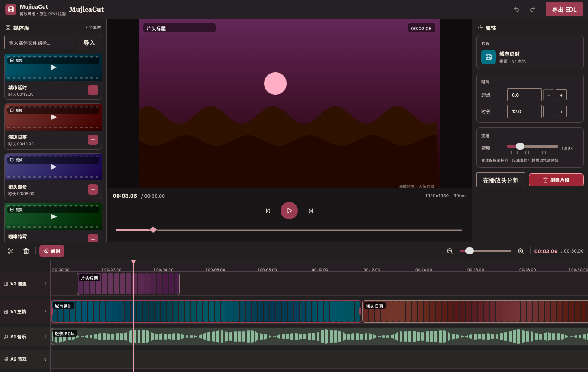

# MujicaCut

一个剪映（CapCut）风格的桌面视频编辑器 demo，基于 [MyGo](https://github.com/egoist/mygo)
（原生 GPU 自绘 UI 运行时）与 [MujicaUI](https://github.com/HycJack/MujicaUI)
（组件库）构建。没有 WebView、没有 HTML、没有 JavaScript —— 整个窗口都是 GPU 画的。



## 功能

- **四轨时间轴**（V2 覆盖 / V1 主轨 / A1 音乐 / A2 音效）：完全自绘 —— 标尺、
  轨道、片段缩略图条、音频波形、播放头、吸附参考线。
- **剪辑操作**：拖拽移动（可跨同类型轨道）、拖拽边缘修剪入/出点、播放头分割、
  删除；磁吸对齐到片段边缘与播放头；重叠自动右推。
- **撤销 / 重做**：整项目快照栈（⌘Z / ⇧⌘Z）。
- **播放器**：空格播放/暂停、逐帧步进、进度条拖拽；播放头移动时时间轴自动跟随。
- **属性检查器**：起点/时长数字输入、音量、变速（保持源素材窗口不变）。
- **媒体库**：内置示例素材（程序合成的示意画面，按素材色相生成，无需解码器）；
  也可输入文件路径导入真实媒体（装了 ffprobe 读真实时长，没装按 15 秒处理）。
- **导出 EDL**：把项目（轨道/片段/入出点）写成 JSON 到 `~/Downloads`。

## 运行

```sh
cd mujicacut
go run .          # 需要图形环境（原生窗口）
```

## 测试与截图

```sh
go test ./...                                            # 渲染冒烟 + 逻辑测试
MYGO_UI_SHOTS=screenshots go test ./internal/app -run TestScreenshots
```

## 快捷键

| 按键 | 作用 |
| --- | --- |
| 空格 | 播放 / 暂停 |
| S | 在播放头分割选中片段 |
| Delete / Backspace | 删除选中片段 |
| ← / → | 逐帧移动播放头 |
| ⌘Z / ⇧⌘Z | 撤销 / 重做 |
| ⌘+ / ⌘- | 时间轴缩放 |
| 拖拽片段 | 移动（可跨同类型轨道） |
| 拖拽片段边缘 | 修剪入点 / 出点 |

## 代码结构

```
mujicacut/
├── main.go                 # 引导：调 app.Run
└── internal/
    ├── editor/             # 模型层：Project/Track/Clip、剪辑操作、undo 栈（不 import UI）
    │   ├── model.go        #   数据与不变量（Clips 按起点有序、互不重叠）
    │   ├── ops.go          #   Add/Move/Trim/Split/Remove/Speed/Volume + 冲突推让
    │   └── history.go      #   整项目快照的撤销栈
    └── app/                # UI 层
        ├── state.go        #   应用状态与动作（播放、分割、导入、导出）
        ├── view.go         #   根布局、标题栏、快捷键
        ├── mediapool.go    #   左侧媒体库（示例素材卡 + 路径导入）
        ├── preview.go      #   中央监视器 + 走带条（程序合成画面）
        ├── inspector.go    #   右侧属性面板
        ├── timeline.go     #   时间轴布局与指针交互（拖拽/修剪/吸附）
        ├── timelinedraw.go #   时间轴绘制（标尺/轨道/片段/波形/播放头）
        └── theme.go        #   主题装配、自补图标、时间码
```

## 诚实的限制

- **没有解码器**：预览与时间轴缩略图是按素材色相 + 源时间程序合成的示意画面；
  播放走的是真实时钟，画面内容会随播放头变化，但不是真实视频帧。
- **导入**依赖手动粘贴路径（MyGo 上游未暴露原生文件对话框，见 MujicaUI 的
  `docs/upstream.md`）；时长探测用 `ffprobe`，未安装则按 15 秒估算。
- **导出**是 EDL JSON，不是渲染成片。
